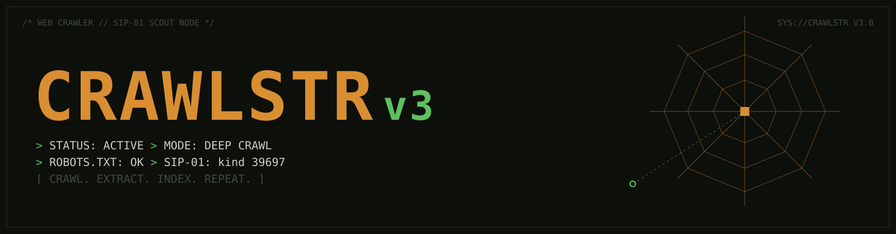
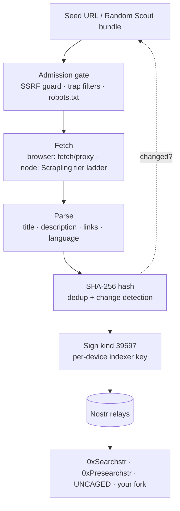

<p align="center">
  
</p>

<h1 align="center">CRAWLSTR v3</h1>

<p align="center">
  <b>Turn any machine into a crawl node for the decentralized web index.</b><br>
  No backend. No accounts. No central crawler. Just Nostr.
</p>

<p align="center">
  <a href="https://github.com/NostrDanish/SIP-01"></a>
  
  
  
</p>

<p align="center">
  🔴 <b>Live:</b> <a href="https://crawlstr.shakespeare.wtf">crawlstr.shakespeare.wtf</a>
</p>

---

Every page a node crawls becomes a **kind 39697 web index observation** on the shared [SIP-01](https://github.com/NostrDanish/SIP-01) index — instantly searchable by [0xSearchstr](https://0xsearchstr.shakespeare.wtf), [0xPresearchstr](https://presearchstr.shakespeare.wtf), [UNCAGED](https://uncaged.shakespeare.wtf), and any SIP-01 client. Adaptive recrawls (24h → 30d) keep the index alive.

## Two runtimes, one index

| | 🪶 **Browser scout** (this app) | 🐍 **Scrapling node** (`scrapling-node/`) |
|---|---|---|
| Runs on | Any browser, incl. a phone on WiFi | VPS / home server / Docker |
| Fetch stack | `fetch` + CORS proxy | [Scrapling](https://github.com/D4Vinci/Scrapling): TLS-impersonated HTTP → headless browser → stealth |
| JS rendering | ✗ | ✓ (Dynamic / Stealthy tiers) |
| Cloudflare-blocked sites | ✗ | ✓ (best effort, `solve_cloudflare`) |
| Queue / state | IndexedDB | SQLite (WAL) |
| Publishes | kind 39697, `source=crawlstr/v3` | kind 39697, `source=crawlstr/v3+scrapling` |

Both sign with a per-device anonymous indexer key and speak byte-identical SIP-01. Run one, or run both.

## Quickstart

**Browser scout**

```bash
git clone https://github.com/SIP-01/Crawlstr-v3.git && cd Crawlstr-v3
npm install && npm run dev
```

Open the printed URL → paste a seed URL (or hit **Random Scout**) → **Start Crawling**.

**Headless node** — see [`scrapling-node/`](scrapling-node/README.md):

```bash
cd scrapling-node
docker compose up -d        # or: pip install -r requirements.txt && python -m sip01_node
```

## How it works



## What it publishes

```json
{
  "kind": 39697,
  "content": "{\"title\":\"Example Page\",\"description\":\"A page about...\"}",
  "tags": [
    ["d", "widx:9f86d081884c7d659a2feaa0c55ad015"],
    ["u", "https://example.com/page"],
    ["x", "e3b0c44298fc1c149afbf4c8996fb92427ae41e4649b934ca495991b7852b855"],
    ["v", "1"], ["l", "en"], ["source", "crawlstr/v3"],
    ["network", "clearnet"], ["type", "page"],
    ["alt", "Web index observation: Example Page"]
  ]
}
```

`d` = URL identity (same across every indexer → independent-observation count) · `x` = content agreement hash · full schema in [NIP.md](NIP.md) and the [canonical spec](https://github.com/NostrDanish/SIP-01/blob/main/public/spec/SIP-01.md).

## Why it's different

Most "decentralized search" projects still run centralized crawlers. Crawlstr makes **every node a crawler** — opt-in, transparent, resource-aware.

- 🎲 **Random Scout** — one button: 5 curated seed bundles, weighted toward fresh/rare corners of the web
- 🔁 **Adaptive freshness** — changed → recrawl in 24h, unchanged → backs off to 30d; every recrawl is a liveness signal
- 🕵️ **Pseudonymous by design** — per-device indexer keypair, never your Nostr identity; events carry page metadata, never queries
- 🐌 **Polite to a fault** — robots.txt, ≤1 in-flight per domain, 5–8s pacing, crawl-trap guards, 7-day negative cache
- 📦 **Offline-first** — zero-ack observations wait in an outbox; "published" means relay-ACKed, never merely-built
- 💓 **Network heartbeat** — kind 16919, counters coarsened to two significant figures before signing

## Relay pool

SIP-01 index relays, NIP-50 search relays, and broad write relays — custom relays merge in via Settings; every relay is NIP-11 probe-able from the dashboard:

`relay-na1.metanomalist.com` · `test-sip-relay.sip-01test.workers.dev` · `sip-relay-2/3/4 *.workers.dev` · `relay.nostr.band` · `relay.ditto.pub` · `search.nos.today` · `relay.noswhere.com` · `jskitty.cat/nostr` · `relay.primal.net` · `relay.damus.io` · `nostr.hifish.org` · Tor `.onion` twin

## Honest limitations (browser runtime)

- **CORS** — direct fetch first, first-party proxy fallback (the proxy sees fetched URLs — never queries, never identity; dashboard shows the split)
- **No JS rendering** — SPAs yield thin content. The Scrapling node closes exactly this gap.
- **Background throttling** — mobile browsers may suspend tabs; the node is most effective while the tab is active
- **SSRF guard** — private/loopback/CGNAT/metadata targets refused on every path, redirects re-checked

<details>
<summary><b>Changelog: v1 → v2 → v3</b></summary>

| | v1 | v2 | v3 (this) |
|---|---|---|---|
| Recrawls | Never — index went stale | Adaptive 24h→30d, liveness republish | kept |
| Failures | 3 flat retries, forgotten | permanent/transient taxonomy, 7d negative cache | kept |
| Dispatch | one serial loop | event-driven, 2 slot runners | robots warm-up is a **scheduled request on the domain lane** — the v2 zero-throughput self-deferral bug is regression-tested dead |
| Trap defense | path-word regex | session keys, query complexity, repeats | + period-2 generator loops, `JSSESSIONID` variants |
| Backoff | — | jitter-after-cap (72min hour) | cap **after** jitter — 1h ceiling is hard |
| Abort | — | `waitForWake` could hang | already-aborted resolves instantly |
| Heartbeat | — | raw counters | coarsened to 2 significant figures |
| Modes | several | several | one-button **Random Scout** |

Source tags: v1 `crawlstr/1` · v2 `crawlstr/v2` · v3 `crawlstr/v3` — all valid SIP-01.

</details>

## Ecosystem

| Project | Role |
|---|---|
| **Crawlstr v3** (this) | Lightweight scout → SIP-01 publisher |
| [Indexstr v3](https://github.com/SIP-01/indexstr-v3) | Distributed indexing network w/ curated collections + sharding |
| [SIP-01](https://github.com/NostrDanish/SIP-01) | Canonical spec + explorer |
| [0xSearchstr](https://github.com/NostrDanish/0xSearchstr) · [0xPresearchstr](https://github.com/NostrDanish/0xPresearchstr) · [UNCAGED](https://github.com/NostrDanish/UNCAGED-ENGINE) | Search engines → SIP-01 readers |

**Crawlstr finds. Indexstr maintains. Nostr distributes. Searchstr searches.**

## Privacy, honestly

No login. No tracking. Observations signed by a per-device key — never your identity. Events contain page metadata only. Relay operators see the event + your IP (that's how Nostr works); use a VPN or Tor — we recommend [NymVPN](https://nym.com/pricing?ref=aYPKAFmGpJi).

## License

MIT · *Vibed with [Shakespeare](https://shakespeare.diy)*
